<picture>
  <source media="(prefers-color-scheme: dark)" srcset="assets/header-dark.svg">
  <source media="(prefers-color-scheme: light)" srcset="assets/header-light.svg">
  
</picture>

<picture>
  <source media="(prefers-color-scheme: dark)" srcset="https://raw.githubusercontent.com/Paul-Antoine-Bonin/Paul-Antoine-Bonin/output/contrib-dark.svg">
  <source media="(prefers-color-scheme: light)" srcset="https://raw.githubusercontent.com/Paul-Antoine-Bonin/Paul-Antoine-Bonin/output/contrib-light.svg">
  
</picture>

  
  

Student at Mines Paris PSL × Albert School (maths, data, finance).
Fixed-term contract at Meta. Previously data analyst intern at BNP Paribas, Lisbon.
Aiming at quantitative trading and ML engineering.

  <a href="https://github.com/pulls?q=is%3Apr+author%3APaul-Antoine-Bonin+org%3Afacebookresearch"><picture>
    <source media="(prefers-color-scheme: dark)" srcset="assets/org-facebookresearch-dark.svg">
    
  </picture></a>
  <a href="https://github.com/pulls?q=is%3Apr+author%3APaul-Antoine-Bonin+org%3Ahuggingface"><picture>
    <source media="(prefers-color-scheme: dark)" srcset="assets/org-huggingface-dark.svg">
    
  </picture></a>

  
  
  
  
  
  
  
  

### Markets

- [kelly-lab](https://github.com/Paul-Antoine-Bonin/kelly-lab): why betting too big ruins you, even with an edge
- [earnings-drift](https://github.com/Paul-Antoine-Bonin/earnings-drift): does post-earnings drift still hold?
- [dividend-drop](https://github.com/Paul-Antoine-Bonin/dividend-drop): does the price really fall by the dividend?
- [odds-calibration](https://github.com/Paul-Antoine-Bonin/odds-calibration): are bookmakers well calibrated?
- [crypto-triangular](https://github.com/Paul-Antoine-Bonin/crypto-triangular): how many triangular arbitrages survive the fees?
- [weekend-effect](https://github.com/Paul-Antoine-Bonin/weekend-effect): calendar anomalies, and why most are not real
- [hedging-words](https://github.com/Paul-Antoine-Bonin/hedging-words): hedging language in corporate communication
- [fx-rates-journal](https://github.com/Paul-Antoine-Bonin/fx-rates-journal): daily ECB euro reference rates as tidy CSV
- [battery-dispatch](https://github.com/Paul-Antoine-Bonin/battery-dispatch): trading a battery on the Portuguese day-ahead power market

### ML and data

- [nanotron-272](https://github.com/Paul-Antoine-Bonin/nanotron-272): where nanotron's bf16 grads get released ([huggingface/nanotron#272](https://github.com/huggingface/nanotron/issues/272), fix in [#438](https://github.com/huggingface/nanotron/pull/438))
- [battery-oracle](https://github.com/Paul-Antoine-Bonin/battery-oracle): predicting Mac battery life better than macOS does
- [timetable-solver](https://github.com/Paul-Antoine-Bonin/timetable-solver): building a timetable with integer programming

### Maths

- [cdis-lean](https://github.com/Paul-Antoine-Bonin/cdis-lean): Lean 4 formalization of the Mines Paris probability course, for ATLAS ([blueprint](https://paul-antoine-bonin.github.io/cdis-lean/))
- [interview-bank](https://github.com/Paul-Antoine-Bonin/interview-bank): quant interview problems, worked through in full
